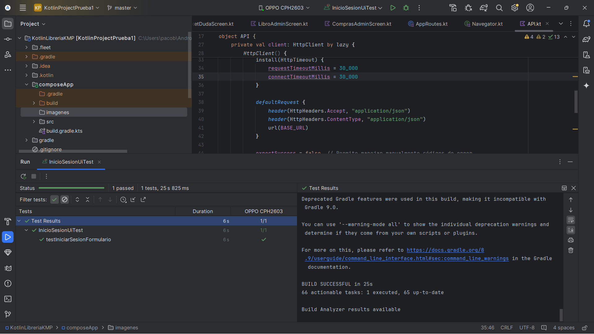
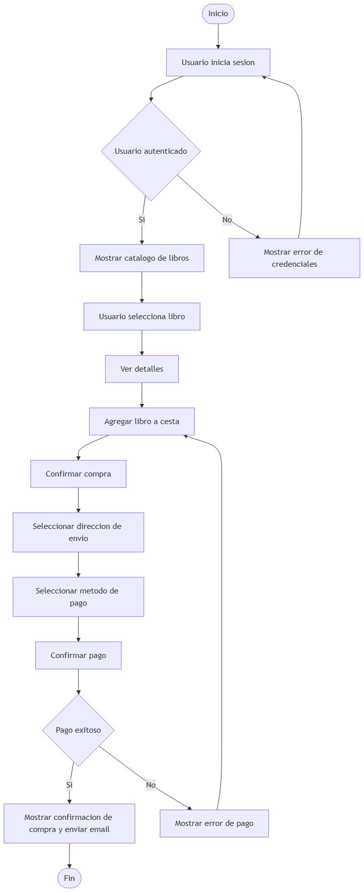

# LeafRead

Aplicación de librería multiplataforma para **Android** y **escritorio**, hecha con Kotlin y Compose Multiplatform. Un único código compartido para las dos plataformas, conectado a una API REST propia.

Proyecto final de ciclo (TFG) de Francisco José Batista de los Santos.



## Qué hace

**Usuario**
- Registro, inicio de sesión y gestión del perfil con avatar.
- Catálogo de libros con filtrado y ficha de detalle.
- Carrito y proceso de compra con direcciones de envío.
- Valoraciones de libros y listado de las propias.
- Tickets de compra y de dudas.

**Administrador**
- Gestión de libros (alta, edición y baja) y de su stock.
- Revisión de compras.
- Atención de los tickets de duda.

## Stack

| Capa | Tecnología |
|---|---|
| UI | Compose Multiplatform |
| Lenguaje | Kotlin 2.1 |
| Arquitectura | MVVM con ViewModels compartidos (Moko MVVM) |
| Red | Ktor Client con `kotlinx.serialization` |
| Navegación | Rutas propias en `commonMain` con implementación por plataforma |
| Imágenes | Coil (Android) y Kamel (escritorio) |
| Seguridad | Autenticación con JWT contra el backend |
| Pruebas | Compose UI Test e instrumentación de Android |
| Backend | [API_TFG_Libreria](https://github.com/fbatlos/API_TFG_Libreria): Spring Boot, Kotlin y MongoDB |
| Prototipo | [Figma](https://www.figma.com/design/d5yVnbsP0XTDM58yEqbFN6/Figma-libreria?node-id=1-2&t=Oi1C7d9sEdZWQSqG-1) |

## Estructura

```
composeApp/src
├── commonMain          Lógica y pantallas compartidas
│   ├── BaseDeDatos     Cliente HTTP, DTOs y modelos
│   ├── Screens         Pantallas de usuario y de administrador
│   ├── ViewModel       Estado y lógica de cada pantalla
│   └── NavController   Rutas de la aplicación
├── androidMain         Actividad, navegación y piezas específicas de Android
├── desktopMain         Punto de entrada y piezas específicas de escritorio
└── androidInstrumentedTest   Pruebas de UI en dispositivo
```

El código específico de cada plataforma se resuelve con `expect`/`actual`, lo que mantiene casi toda la app en `commonMain`.

## Diagrama de flujo



## Cómo ejecutarlo

Requisitos: JDK 17 o superior y, para Android, Android Studio con un emulador o un dispositivo.

```bash
git clone https://github.com/fbatlos/KotlinLibreriaKMP.git
cd KotlinLibreriaKMP

# Escritorio
./gradlew :composeApp:run

# Android: abre el proyecto en Android Studio y ejecuta la configuración composeApp
```

La app apunta por defecto a la API desplegada en Render (`BASE_URL` en `composeApp/src/commonMain/.../BaseDeDatos/API.kt`). Si la API está dormida, la primera petición puede tardar. Para usar tu propio backend, cambia esa constante y levanta [API_TFG_Libreria](https://github.com/fbatlos/API_TFG_Libreria).

Para generar instaladores de escritorio (`.msi`, `.dmg`, `.deb`): `./gradlew :composeApp:packageDistributionForCurrentOS`.

## Pruebas

Hay una prueba de UI instrumentada en Android (`inicioSesionTest`) que valida el formulario de inicio de sesión. La captura de arriba muestra su ejecución.

## Lo que aprendí

- Compartir lógica y pantallas entre Android y escritorio con Kotlin Multiplatform, y decidir qué debe ir por plataforma.
- Consumir una API con autenticación JWT desde un cliente multiplataforma y manejar sus errores.
- Diseñar un flujo completo de comercio: catálogo, carrito, direcciones, compras y roles de administración.
- Desplegar un backend en un servicio gratuito y convivir con sus limitaciones.

## Mejoras previstas

- Más pruebas automáticas, también en `commonMain`.
- Modo sin conexión en escritorio.
- Soporte multilenguaje.
- Mejor sistema de estadísticas para el administrador.
- Mover la URL de la API a configuración por entorno.

## Autor

**Francisco José Batista de los Santos**: desarrollador backend y full-stack junior.
GitHub: [@fbatlos](https://github.com/fbatlos)
